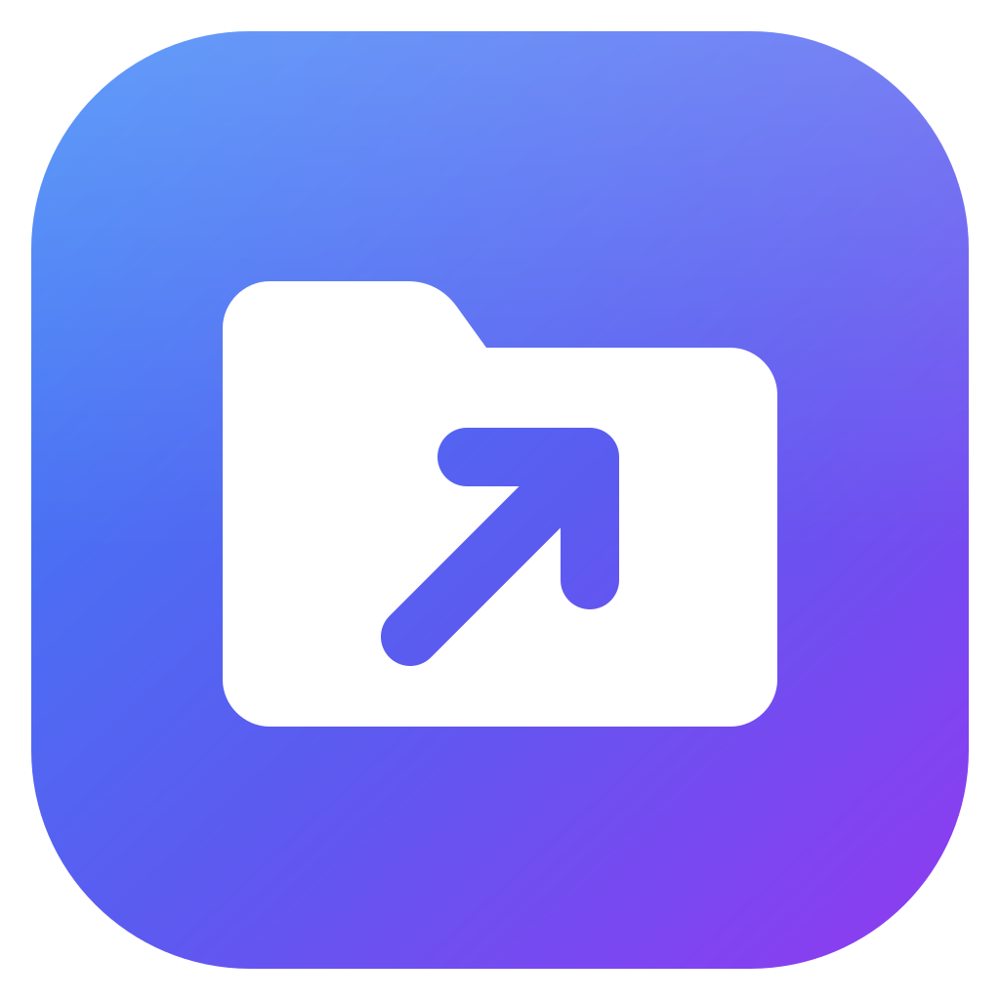
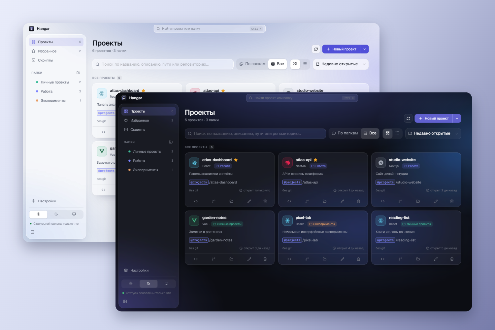
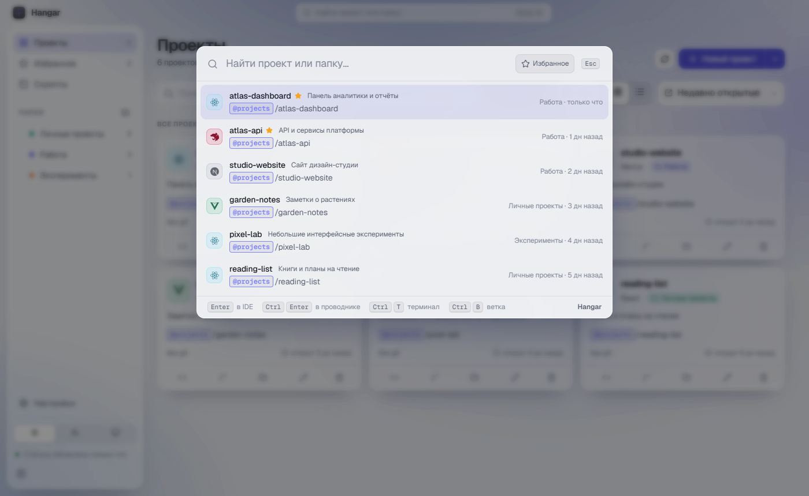

<div align="center">
  
  <h1>Hangar</h1>
  <p><strong>Все проекты под рукой.</strong><br>Личный хаб для работы с репозиториями, папками и IDE.</p>
  <p>
    
    
    
    
  </p>
</div>

Hangar помогает собрать рабочие и личные проекты в одном месте, быстро найти нужный и открыть его в привычных инструментах. Данные проектов и настройки хранятся локально.



<details>
<summary>Быстрый поиск</summary>



</details>

На скриншотах показаны демонстрационные проекты.

## ✨ Возможности

| Организация | Быстрый доступ |
| --- | --- |
| Проекты с описаниями, избранное и цветные папки до трёх уровней | Поиск проектов и папок, фильтр избранного |
| Импорт проектов с сохранением структуры папок | Открытие в IDE, проводнике и терминале |
| Алиасы путей и ссылки на таск-трекеры | Состояние Git и переключение веток |
| Автоматическое определение стека проекта | Глобальный поиск, трей и автозапуск |

Светлая, тёмная и системная темы, вид карточками или списком, а также режим окна поверх остальных помогают настроить приложение под себя. Раздел скриптов пока находится в разработке.

## 🔎 Быстрый поиск

Откройте поиск через кнопку в шапке или `Ctrl+K`. Глобальное сочетание по умолчанию — `Ctrl+Shift+Space`.

| Клавиши | Действие |
| --- | --- |
| `Enter` | Открыть проект в IDE или перейти в папку |
| `Ctrl+Enter` | Открыть проект в проводнике |
| `Ctrl+T` | Открыть терминал проекта |
| `Ctrl+B` | Выбрать ветку Git |

Сочетания с `Ctrl` на macOS используют `⌘`. Глобальную комбинацию можно изменить в настройках.

## 📦 Установка

После публикации альфы установщики будут доступны на [странице релизов](https://github.com/yavabit/hangar/releases). Выберите файл для своей системы: Windows — установщик `.exe`, macOS — `.dmg`, Linux — `.AppImage` или `.deb`.

Первая альфа ещё готовится. Приложение пока не подписано сертификатом: Windows и macOS могут показать предупреждение при установке или первом запуске.

Для Git-статусов нужен `git` в `PATH`. Для открытия проектов используйте установленную IDE и её CLI (`code`, `webstorm` или `idea`); в некоторых случаях используется ссылка-протокол IDE.

## 🔄 Обновления

В настройках можно проверить обновления вручную, включить или выключить автоматическую проверку и скачивание. Альфа-версии получают ранние обновления; на стабильной версии их можно включить переключателем «Ранние версии».

На macOS новая версия открывается на странице загрузки и устанавливается вручную. Работа обновлений и установщиков на разных платформах требует проверки на опубликованных релизах.

## 🛠️ Разработка

Проект использует Electron, React, TypeScript, Ant Design и Zustand.

```bash
npm install
npm run dev
```

```bash
npm run typecheck
npm run lint
npm run build:win
npm run build:mac
npm run build:linux
```

Сборки для соответствующих систем удобнее запускать на самих Windows, macOS и Linux. В `package.json` разрешён установочный скрипт Electron через `allowScripts`.

| Каталог | Назначение |
| --- | --- |
| `src/main` | Окна, системные действия, хранилище, Git и обновления |
| `src/preload` | Мост между интерфейсом и основным процессом |
| `src/renderer` | Интерфейс приложения |
| `src/shared` | Общие типы, схемы и утилиты |
| `build` | Иконки и ресурсы сборки |
| `out` / `dist` | Результат компиляции / установщики; не хранятся в Git |

## 🚀 Релизы

[GitHub Actions](.github/workflows/release.yml) запускается при отправке тега `v*`, совпадающего с версией в `package.json`. Пайплайн создаёт черновик релиза и собирает пакеты для трёх систем; черновик нужно проверить и опубликовать вручную.

Текущая версия — `1.0.0-alpha.0`. Для следующей альфы можно использовать `npm version prerelease --preid alpha`: команда обновит версию и создаст коммит и тег. Отправка коммита и тега выполняется отдельно.

## 🔐 Данные и безопасность

На Windows данные находятся в `%APPDATA%\Hangar`: проекты и настройки — в `launcher-data.json`. В режиме разработчика доступны экспорт и импорт данных, просмотр информации о приложении и экран первого запуска. Перед переносом или обновлением полезно сделать резервную копию.

Интерфейс работает в песочнице Electron и обращается к системным операциям через preload-мост. Git-статусы проверяются локально; проверка обновлений обращается к GitHub и отключается в настройках.

## 📄 Лицензия

[GNU GPL v3 или более поздняя](LICENSE).
